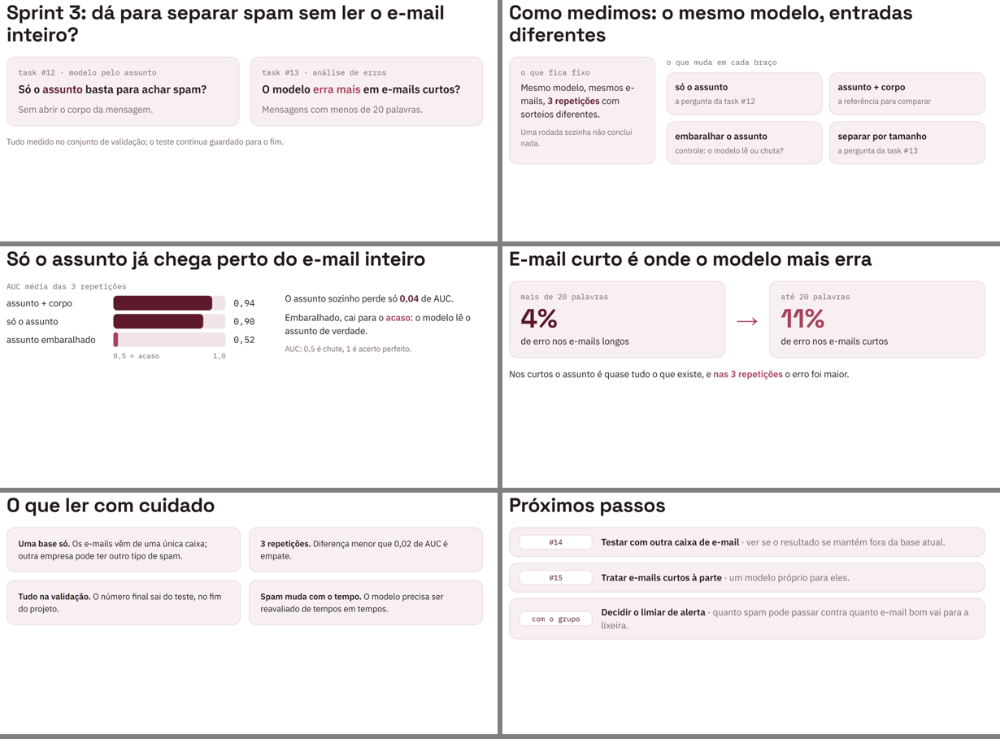

# slides-faculdade

Uma **skill do [Claude Code](https://claude.com/claude-code)** que gera
slides de apresentação de projetos de faculdade (sprint, entrega
parcial, resultado de task) no modelo de cabeçalho da turma, e entrega
**.pptx e .pdf** com o mesmo visual.

Você pede "faz os slides da sprint 3" e o Claude:

1. lê o material do projeto (relatório, README, tasks), que é a única
   fonte dos números;
2. monta o roteiro: perguntas → método → um resultado por slide →
   ressalvas → próximos passos, com cada título dizendo a conclusão;
3. desenha cada slide em HTML, com cards, barras e números grandes;
4. **confere sozinho** se algum texto passou da área e olha as imagens
   de revisão antes de entregar;
5. monta o `.pptx` (cabeçalho editável e notas do apresentador em cada
   slide) e o `.pdf`.



> O deck de `exemplos/exemplo.py` (um classificador de spam) usa
> **dados fictícios**. Ele existe para mostrar os layouts.

## Requisitos

- [Claude Code](https://claude.com/claude-code)
- Python 3.10+ com [Pillow](https://pypi.org/project/pillow/) (`pip install pillow`)
- Node.js 18+ e npm (o `pptxgenjs` é instalado sozinho no primeiro uso)
- Google Chrome ou Microsoft Edge (ou defina a variável `CHROME` com o
  caminho do executável)

## Instalação

**Para todos os seus projetos** (skill pessoal):

```bash
git clone https://github.com/miguelcastell/skill-slides-faculdade ~/.claude/skills/slides-faculdade
```

**Só para um projeto:**

```bash
git clone https://github.com/miguelcastell/skill-slides-faculdade .claude/skills/slides-faculdade
```

Para atualizar, rode `git pull` dentro da pasta.

## Configuração por projeto

Crie um `slides.json` na raiz do projeto. Se ele não existir, o Claude
pergunta o que falta e cria:

```json
{
  "nome": "Fulano de Tal",
  "titulo": "Atividades - {nome}",
  "subtitulo": "Tasks",
  "logo": "docs/logo-faculdade.png",
  "destino": "docs",
  "arquivo": "Sprint {sprint:02d} - {nome}"
}
```

| chave | o que é | padrão |
|---|---|---|
| `nome` | quem apresenta (obrigatório) | — |
| `titulo` | primeira linha do cabeçalho; aceita `{nome}` | `Atividades - {nome}` |
| `subtitulo` | segunda linha do cabeçalho | `Tasks` |
| `logo` | imagem no canto direito do cabeçalho | sem logo |
| `destino` | pasta dos arquivos finais | pasta atual |
| `arquivo` | modelo do nome do arquivo; aceita `{sprint}` e `{nome}` | `Sprint {sprint:02d} - {nome}` |
| `trabalho` | pasta dos intermediários | `.slides-build` |

Coloque `.slides-build/` no `.gitignore` do projeto.

Para usar o modelo da sua turma (outras posições de cabeçalho, outro
logo, outras cores), veja `references/modelo-da-turma.md`.

## Usar sem o Claude

```bash
python scripts/construir.py exemplos/exemplo.py --nome "Fulano de Tal" --saida "Exemplo" --so-revisao
python scripts/construir.py exemplos/exemplo.py --nome "Fulano de Tal" --saida "Exemplo"
```

O primeiro comando gera só as imagens de revisão, em
`.slides-build/Exemplo/revisao_*.png`. O segundo gera `Exemplo.pptx` e
`Exemplo.pdf`.

## Estrutura

```
SKILL.md                 instruções que o Claude segue
scripts/construir.py     HTML → PNG → .pptx + .pdf, com a checagem de estouro
scripts/componentes.py   tema e blocos (card, barra, numero, chip, ...)
scripts/montar_pptx.js   montagem do .pptx (pptxgenjs)
references/              roteiro, estilo e modelo da turma
exemplos/exemplo.py      deck de exemplo (dados fictícios)
```
